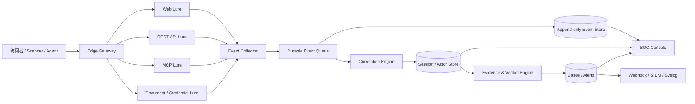

# AI Agent Honeypot 产品与技术设计

> 状态：v0.1 产品定义稿  
> 目标用户：企业安全运营中心（SOC）、安全运营团队、应急响应与威胁情报团队  
> 产品形态：Web 服务 / API 服务，兼容 MCP 诱饵面  
> 商业策略：开源优先，预留企业商业版  

## 1. 产品定义

### 1.1 一句话定义

AI Agent Honeypot 是一套面向企业 SOC 的 Agent 欺骗感知与溯源平台。它通过部署机器可读的 Web、API、文档、凭证和 MCP 诱饵，识别访问企业数字资产的自动化客户端和自主 AI Agent，并输出可解释、可回放、可验证的会话证据。

### 1.2 我们解决的问题

企业正在面对越来越多具备浏览、检索、调用 API、使用工具和执行多步任务能力的自动化客户端。传统 WAF、Bot 管理和蜜罐可以发现异常请求，却通常无法回答：

- 访问者是浏览器、链接预取器、搜索爬虫、普通扫描器，还是自主 Agent？
- 它是否理解了页面或 API 中的机器可读信息？
- 它是否完成了发现、枚举、调用、凭证复用或跨入口访问等多步行为？
- 同一个访问者在 Web、API、MCP 和凭证入口上的行为能否串成一条证据链？
- 访问者来自 Strix、CyberStrike、Cairn 等红队框架，还是裸 Claude Code、Codex、Pi 等通用 Agent Harness？
- 上层编排框架、底层 Agent Harness、基础模型和操作者基础设施能否分别归因？
- SOC 为什么应该相信某个“AI Agent”判定，而不是接受一个黑盒标签？

本产品的核心不是阻断，也不是反击，而是让企业获得此前缺失的三种能力：

1. **感知**：发现机器客户端和疑似自主 Agent 的访问。
2. **归因**：把跨入口行为关联到同一会话、来源与行为主体，并在证据允许时识别其框架家族。
3. **举证**：输出带原始事件、时间线、判定依据和置信度的可验证证据。

产品的标准调查产出是一个 **Agent Investigation Package**，其中包含：

- Agent 身份与自主性结论。
- 完整行为日志和有因果关系的决策轨迹。
- 能力画像与攻击目标。
- Agent 家族归因与候选排名。
- 来源基础设施和操作者线索。
- 每项结论对应的证据、反证与置信度。

### 1.3 产品边界

产品默认只在客户拥有或明确授权的资产中工作，并遵循 Observe-first 原则。

我们不做：

- C2 控制、Beacon 生成、远程任务下发或持久化控制。
- MSF、漏洞利用、攻击载荷生成或主动入侵。
- 对访问者设备执行代码、反向连接或跨出客户授权边界。
- 使用真实客户数据、真实凭证或真实内部系统作为诱饵。
- 仅根据 User-Agent 就宣称识别出具体 Agent 产品。
- 为了溯源而入侵、扫描或控制访问者的设备和基础设施。
- 用无限循环、恶意大响应或高成本交互主动消耗对方资源。
- 用无法解释的 LLM 结论替代原始证据和确定性规则。

## 2. 目标用户与使用场景

### 2.1 首要用户：企业 SOC

SOC 分析师需要在现有告警流程中完成发现、调查、定级和处置。本产品必须提供证据，不应要求分析师相信营销式的“AI 检测率”。

典型使用者：

- SOC 一线分析师：接收高信号告警、查看会话时间线。
- 威胁猎手：搜索跨节点、跨协议的行为模式。
- 应急响应团队：确认诱饵凭证、文档或 API 是否被访问和复用。
- 安全架构师：评估互联网业务和内部网络中的 Agent 暴露面。
- 威胁情报团队：沉淀 Agent 行为指纹和攻击活动样本。

### 2.2 首版核心场景

#### 场景 A：互联网 Web/API Agent 访问感知

企业在公开站点、开发者门户或 API 网关附近部署机器可读诱饵。系统观察访问者是否发现隐藏但合法可达的接口、读取结构化说明、调用诱饵 API，以及是否在后续请求中携带水印。

#### 场景 B：诱饵凭证泄露与复用溯源

系统生成无真实权限、只能访问诱饵面的唯一凭证。凭证被读取、复制或用于访问时，SOC 能够追溯其投放位置、初始会话和复用路径。

#### 场景 C：MCP 探测与工具行为观察

部署 synthetic-only MCP 服务，提供无真实后端的假工具。记录客户端初始化、工具枚举、工具选择、参数形态、错误恢复和多步调用序列。

#### 场景 D：内部横向侦察早期告警

在仅应被授权系统访问的位置投放假 API 文档、假内部服务入口或假凭证。任何命中都作为高信号事件，但不向访问者提供真实资源或主动反击能力。

## 3. 产品原则

1. **证据优先**：任何 Agent 判定必须能展开为原始事件和判定理由。
2. **归因优先**：孤立请求价值有限，默认按会话和行为链组织数据。
3. **Web/API 优先**：产品首先是企业可部署的 Web/API 服务，MCP 是重要诱饵面而不是全部产品。
4. **机器可读优先**：诱饵应符合 Agent 实际消费信息的方式，包括 JSON、OpenAPI、文档、工具定义和结构化错误。
5. **合规安全**：默认不反击、不出界、不使用真实数据、不造成实质性资源消耗。
6. **低误报**：明确区分浏览器、预取器、已声明爬虫、扫描器和疑似 Agent。
7. **确定性为主**：协议解析、事件关联和规则评分采用确定性逻辑；LLM 只能辅助摘要和调查。
8. **可独立验证**：每个诱饵、规则和结论都应有可重复测试方法。
9. **易于接入**：先支持旁路或独立域名部署，不要求改造企业核心业务。
10. **开源可信**：核心传感、证据模型和基础判定公开，允许客户验证产品行为。

## 4. 身份分类与证据等级

### 4.1 为什么不直接输出“这是某某 Agent”

User-Agent、请求头、IP 和客户端名称均可伪造。单次 Canary 回调也可能来自浏览器预取、聊天软件预览或安全扫描产品。因此平台必须区分“观察事实”和“分析推断”。

### 4.2 访问者分类

平台使用分层标签，而不是简单的 Agent / 非 Agent 二分类：

| 分类 | 含义 | 典型证据 |
| --- | --- | --- |
| Human browser | 常规人工浏览 | 浏览器行为、页面资源加载、交互节奏 |
| Prefetcher / Unfurler | 链接预取或消息预览 | 无页面上下文、固定抓取模式、只请求链接 |
| Declared crawler | 主动声明身份的内容爬虫 | UA、网络归属、robots 行为；默认仍为“声明身份” |
| Automated scanner | 通用扫描器或漏洞探测脚本 | 高频路径字典、固定请求序列、缺少语义跟进 |
| Tool client | 能够发现并调用 API/MCP 工具的客户端 | 协议握手、枚举、结构化调用 |
| Suspected AI agent | 行为呈现语义驱动和多步适应 | 根据返回内容调整下一步、错误恢复、跨入口关联 |
| Behavior-confirmed agent | 在受控实验或多信号条件下确认的 Agent | 独立身份信号 + 多步语义行为 + Canary 传播 |

### 4.3 证据等级

每个 Actor Verdict 输出一个证据等级：

- **E0 — Unknown**：只有普通访问事件。
- **E1 — Claimed**：客户端自报身份，但没有独立验证。
- **E2 — Automated**：可以确认是自动化客户端，尚不能证明使用 LLM。
- **E3 — Agent-like**：出现多步、自适应、语义相关的工具或 API 行为。
- **E4 — Corroborated**：多个独立信号共同支持 Agent 判断。
- **E5 — Controlled verified**：在企业自测、实验或已知 Agent 环境中完成身份验证。

野外流量通常只能达到 E2–E4。平台不得把 E3 自动宣传成具体品牌或模型。

### 4.4 证据类型

- 网络证据：来源、ASN、TLS/HTTP 指纹、头部顺序、连接复用。
- 协议证据：MCP 版本、初始化能力、JSON-RPC 序列、OpenAPI 使用方式。
- 时间证据：请求间隔、思考停顿、退避、重试和并发模式。
- 语义行为证据：是否根据诱饵响应选择下一步工具或参数。
- Canary 证据：唯一标记是否跨响应、跨入口或跨会话传播。
- 凭证证据：唯一诱饵凭证是否被读取和在何处复用。
- 一致性证据：同一主体的多次访问是否呈现稳定行为指纹。

### 4.5 Agent 家族归因

#### 4.5.1 归因目标

平台不仅判断“是不是 Agent”，还需要回答“更像哪一类 Agent”。首批重点覆盖：

- 自动化红队 / 渗透框架：Strix、CyberStrike、CyberStrikeAI、Cairn，以及后续纳入的主流框架。
- 通用 Agent Harness：Claude Code、Codex、Pi、OpenCode 等。
- 自定义 Agent：无法映射到公开产品，但呈现稳定且可聚类的私有运行时。

家族归因是候选推断，不是品牌认证。除非存在不可伪造或经过独立验证的信号，否则输出应采用“候选 + 置信度 + 证据”的形式。

#### 4.5.2 必须拆开的四层身份

一个攻击活动可能同时使用多个组件。例如 Cairn 可以调度 Claude Code、Codex 或 Pi 作为 Worker；Strix 和 CyberStrike 也可以接入不同模型。因此不能用一个 `agent_name` 字段描述全部身份。

| 层级 | 需要回答的问题 | 示例 |
| --- | --- | --- |
| Orchestration framework | 谁在规划任务、分配步骤和管理状态？ | Strix、CyberStrike、Cairn、自定义编排器 |
| Agent harness / worker | 谁实际发起工具调用和命令执行？ | Claude Code、Codex、Pi、OpenCode |
| Model/provider | 推理可能由哪个模型或服务提供？ | Claude、GPT、Gemini、本地模型、未知 |
| Operator/infrastructure | 谁在运行它，从哪里运行？ | 云主机、企业出口、代理网络、个人终端、未知操作者 |

任何一层都可以为 `unknown`。平台不得因为识别出 Claude Code 风格的 Worker 就断言上层没有 Cairn，也不得因为行为类似 Strix 就断言底层模型身份。

#### 4.5.3 家族指纹来源

家族指纹库由可复现实验产生，主要观察：

- HTTP/TLS、Header 顺序、默认 User-Agent 和连接行为。
- MCP capability negotiation、协议版本和客户端元数据。
- 工具发现、排序、选择和参数序列化习惯。
- JSON 空值、布尔值、数组、枚举和未知字段处理。
- 错误重试、超时、退避、并发和取消模式。
- 多 Agent 编排产生的并发扇出、角色切换与重复验证。
- 上下文文件发现顺序，例如 `AGENTS.md`、`CLAUDE.md` 和其他项目指令文件。
- 相同信息在 Web、REST、MCP 和 Shell 表面之间的传播方式。
- 会话长度、阶段边界、总结/压缩后行为变化。
- 框架特有但可公开验证的请求结构、任务状态或工具命名模式。

其中任何单一特征都不应直接产生高置信度品牌结论。高置信度家族归因至少需要两个不同类别的独立证据。

#### 4.5.4 候选排名输出

示例：

```json
{
  "orchestration_candidates": [
    {
      "family": "cairn-like",
      "confidence": 0.78,
      "evidence": ["parallel_worker_fanout", "fact_intent_style_revisit"],
      "counter_evidence": ["no_stable_board_polling_observed"]
    },
    {
      "family": "custom-multi-agent",
      "confidence": 0.46,
      "evidence": ["parallel_worker_fanout"]
    }
  ],
  "harness_candidates": [
    {
      "family": "claude-code-like",
      "confidence": 0.84,
      "evidence": ["tool_argument_shape_v3", "instruction_file_sequence"]
    }
  ],
  "model_provider": {
    "family": "unknown",
    "confidence": 0.0
  }
}
```

控制台必须允许分析师展开每个指纹的原始事件、适用版本、首次/末次观察时间和已知碰撞家族。

### 4.6 操作者与攻击基础设施溯源

#### 4.6.1 被动溯源（产品能力）

被动溯源在不影响、不访问对方设备的前提下聚合：

- 来源 IP、ASN、云服务商、代理/Tor 线索和网络所有权。
- TLS/HTTP 指纹、Header 规范化特征和连接复用模式。
- 时间区间、活跃周期、时区倾向和重复访问规律。
- 跨 Sensor 的 Canary、凭证、工具序列和行为指纹复用。
- 攻击中主动暴露的域名、回连地址、仓库、邮箱、钱包或其他 IOC。
- 同一操作者在多个 Agent 家族间切换时仍然稳定的基础设施与操作习惯。

产出是 `Operator Hypothesis`，而不是未经证实的真实身份：

```text
操作者假设：同一活动集群 OP-2026-0042
置信度：中等
基础设施：同一云 ASN，3 个轮换源地址
稳定特征：UTC+8 活跃窗口、相同工具调用错误、同一 Canary 复用
真实个人/组织身份：未知
```

#### 4.6.2 交互式归因（受控产品能力）

平台可以在自有诱饵环境内，通过无害、可审计的交互提高归因质量：

- 为每个会话生成不同的 Canary、文档内容和 API 对象。
- 对不同候选家族返回等价但结构略有差异的响应，观察其解析与选择行为。
- 使用签名 nonce 验证跨步骤、跨入口和跨会话传播。
- 提供仅能访问本平台的无权限假凭证，观察何时、从何处被复用。
- 使用受控错误、能力协商和协议边界条件区分不同运行时。

这些动作全部发生在防守方控制的系统内，不执行对方代码，不主动连接对方设备，不利用对方漏洞。

#### 4.6.3 主动反制溯源（未来研究项，默认禁用）

未来可以研究更主动的归因机制，但必须作为独立、默认关闭、需法务与授权审批的能力域，不能混入开源 MVP。研究目标可以包括：

- 设计可跨攻击链传播、但不具真实权限的水印数据。
- 观察诱饵资产是否从新的来源或新的工具链被再次使用。
- 在防守方拥有的回调端点上验证 Agent 对数据或链接的处理路径。
- 通过多轮受控交互提高框架、活动集群和操作者基础设施的关联置信度。

即使进入该阶段，也明确禁止：

- Hack back、入侵或扫描攻击者基础设施。
- 下发、诱导执行恶意代码或建立持久化控制。
- 收集与防御目的无关的个人信息。
- 使用真实密钥、真实客户数据或可能伤害第三方的载荷。
- 绕过地域法律、客户授权范围或企业审批流程。

该能力的合理定位是 **Active Attribution Research**，而不是“反杀”或 C2。

## 5. 诱饵面设计

### 5.1 Web 诱饵

- 合法可达但正常用户无需访问的路径。
- 页面中的机器可读链接、元数据和开发者入口。
- `robots.txt`、`sitemap.xml`、`.well-known/*` 等发现入口。
- 结构化错误页面和带唯一水印的文档。
- 可配置的假登录页、管理页和内部知识页面。

Web 诱饵不能依赖隐藏恶意指令，不执行浏览器漏洞利用，也不采集与判断无关的个人信息。

### 5.2 REST/API 诱饵

- OpenAPI 描述和开发者文档。
- JSON 资源发现接口。
- 只返回合成数据的查询接口。
- 唯一、无权限的诱饵 API Key。
- 能观察分页、筛选、错误恢复和调用链的 API。

所有返回数据必须标记为 synthetic，并在服务端保证不存在真实后端访问路径。

### 5.3 MCP 诱饵

首版支持：

- Streamable HTTP 传输。
- `initialize`、`tools/list`、`tools/call`。
- 基础资源和提示能力可在后续版本加入。
- 可配置的 Persona 和工具目录。
- 无真实执行能力的确定性响应。

建议首批工具 Persona：

- `internal-docs`：内部文档查询。
- `customer-analytics`：合成客户数据分析。
- `cloud-ops`：无真实权限的云资源查询。
- `code-repository`：合成仓库和构建信息。

### 5.4 Canary 与凭证诱饵

Canary 必须满足：

- 每次投放唯一。
- 不授予任何真实权限。
- 可撤销、可过期。
- 可映射到租户、节点、诱饵、会话和生成时间。
- 日志中默认只展示安全摘要，敏感原值受权限控制。

## 6. 会话与归因模型

### 6.1 核心对象

- **Tenant**：客户组织。
- **Site**：被保护或部署诱饵的业务站点。
- **Sensor**：独立部署的采集节点。
- **Surface**：Web、REST、MCP、Document、Credential 等入口。
- **Lure**：具体诱饵定义和版本。
- **Token**：唯一 Canary 或诱饵凭证。
- **Event**：不可变的原始观测事件。
- **Session**：一组存在直接关联的事件。
- **Actor**：基于多个会话聚合出的行为主体。
- **Evidence**：支持或反驳某个判断的证据项。
- **Verdict**：带等级、置信度、理由和版本的分析结论。
- **FamilySignature**：某个框架、Harness 或运行时版本的可复现指纹定义。
- **AttributionHypothesis**：框架、Harness、模型或操作者层的候选归因。
- **Campaign**：跨会话、跨 Sensor 聚合出的活动集群。
- **Case**：SOC 调查事件。

### 6.2 关联策略

强关联信号优先于弱关联信号：

1. 唯一 Canary 或诱饵凭证。
2. 协议会话 ID 或平台签发的匿名会话 ID。
3. 同一连接或明确的请求链。
4. 稳定客户端指纹与紧密时间窗口。
5. IP、UA 等弱信号。

平台必须保存“为什么合并”和“为什么没有合并”的解释，禁止仅凭 IP 永久合并 Actor。

### 6.3 事件不可变，结论可重算

原始事件采用 append-only 设计。规则、权重和模型升级后可以重算 Verdict，但不能修改原始事实。每个结论记录：

- 规则集版本。
- 计算时间。
- 支持证据。
- 反证和不确定性。
- 置信度。
- 推荐处置。

## 7. SOC 产品体验

### 7.1 Dashboard

首页重点展示：

- 今日高信号 Agent-like 会话。
- 按分类划分的访问量，而非笼统“攻击量”。
- Web、API、MCP 诱饵命中趋势。
- E0–E5 证据等级分布。
- 新出现的工具序列和行为指纹。
- 重复访问和跨入口复用情况。

### 7.2 会话调查页

单个会话至少包括：

- 完整时间线。
- 原始请求和安全处理后的响应摘要。
- 诱饵与 Canary 来源。
- 每一步行为对应的证据项。
- 当前分类、证据等级、置信度和理由。
- 上层框架、Agent Harness、模型和操作者四层候选归因。
- 家族指纹命中、反证、适用版本与已知碰撞。
- 支持证据与反证。
- 跨入口关联图。
- JSON、CSV 和调查报告导出。

### 7.3 告警设计

默认高信号告警包括：

- 唯一诱饵凭证被使用。
- Canary 跨入口传播。
- MCP 工具完成多步语义调用。
- 客户端根据合成数据产生后续定向行为。
- 同一 Actor 在多个站点或 Sensor 重复出现。
- 某个已知红队 Agent 家族首次出现，或家族候选置信度显著上升。
- 同一操作者活动集群切换了 Agent 框架或 Harness。
- 被标记为扫描器的客户端升级为 Agent-like 行为。

只访问首页、只加载 Canary URL、只枚举一次工具默认不应触发最高级告警。

### 7.4 集成

开源版首批集成：

- 通用 Webhook。
- Syslog / CEF。
- JSONL 导出。
- Prometheus 指标。

后续企业版可提供 Splunk、Microsoft Sentinel、Elastic、飞书、钉钉等经过维护的连接器。

## 8. 总体架构



### 8.1 建议技术栈

首版以可维护和易部署为优先：

- 后端：Python 3.12 + FastAPI。
- 数据模型：SQLAlchemy 2 + Alembic。
- 开发与单节点：SQLite WAL。
- 生产：PostgreSQL。
- 异步任务：首版使用数据库任务表；规模化后再引入 Redis/NATS。
- 前端：服务端渲染或轻量 React 控制台，避免首版前后端过度拆分。
- 部署：Docker Compose 起步，后续提供 Helm Chart。
- 遥测：OpenTelemetry + Prometheus。

### 8.2 安全分区

- **Exposure Zone**：对外暴露的诱饵面，无真实数据和真实控制能力。
- **Collection Zone**：只接受结构化事件，进行大小限制、清洗和脱敏。
- **Analysis Zone**：关联、评分、生成证据和告警。
- **Control Zone**：租户配置、用户权限、规则和审计日志。

诱饵运行时默认禁止任意出网，不能把访问者提供的 URL 交给后端请求，不能执行访问者提供的命令或代码。

## 9. 检测与评分

### 9.1 首版采用规则和状态机

首版不训练“AI Agent 分类模型”，而使用可解释的规则和行为状态机：

```text
discovered_surface
  -> enumerated_capabilities
  -> selected_semantic_tool
  -> supplied_structured_arguments
  -> adapted_after_result_or_error
  -> reused_canary_or_credential
  -> revisited_or_crossed_surface
```

每一步产生正向证据，也允许产生反证。例如固定字典扫描命中了多个入口，但从不根据响应改变请求，则更支持 scanner，而不是 agent。

### 9.2 评分输出

评分不是单一“恶意值”，而是至少包含：

- `automation_confidence`
- `agentic_behavior_confidence`
- `malicious_intent_confidence`
- `identity_confidence`
- `evidence_level`

自动化、Agent 性和恶意性是三个不同维度。一个企业内部合法 Agent 可以具有很高的 Agent 性，但恶意性为零。

### 9.3 LLM 的有限用途

LLM 可以用于：

- 为分析师生成会话摘要。
- 把工具调用序列映射成调查语言。
- 提议待人工确认的新规则。
- 对聚类结果生成可读标签。

LLM 不可以：

- 直接决定是否封禁。
- 覆盖原始事件。
- 在没有证据引用的情况下判定具体产品或模型。
- 接收未脱敏的凭证或客户敏感数据。

## 10. 隐私、合规与防滥用

### 10.1 默认最小化采集

- 只采集完成安全判定所需字段。
- 请求体按路由配置 allowlist，默认不全量保存。
- Authorization、Cookie、密码字段默认哈希或遮盖。
- 支持租户级保留周期和立即删除。
- 导出数据默认脱敏。
- 管理操作全部进入不可变审计日志。

### 10.2 安全保证

- 合成数据和真实数据物理或逻辑隔离。
- 诱饵凭证在真实系统中永远无权限。
- 无命令执行、无任意文件读取、无 SSRF。
- 对请求体、工具参数、响应大小和会话时长设置上限。
- 对诱饵自身做持续安全测试。
- 公开安全策略和漏洞报告渠道。

### 10.3 允许与禁止的用途

允许：在自有、授权或实验环境中进行欺骗监测、研究和评估。

禁止：将系统用于未授权跟踪、恶意投毒、攻击他人设备、隐藏式资源消耗或收集无关个人信息。

## 11. 开源版与商业版

### 11.1 开源版

开源版必须是真正可用的单组织产品，而不是残缺 Demo：

- Web、REST 和 MCP 诱饵运行时。
- Persona 与 Lure 配置。
- Event、Session、Evidence、Verdict 基础模型。
- 基础规则引擎和证据等级。
- 单节点 SOC 控制台。
- Webhook、Syslog、JSONL。
- SQLite / PostgreSQL。
- Docker Compose 部署。
- 完整测试与示例实验。

### 11.2 商业版

商业版围绕企业规模、运营和服务能力收费：

- 多租户与组织层级。
- SSO、SAML/OIDC、SCIM、细粒度 RBAC。
- 多节点集中管理和大规模策略下发。
- 高可用、数据分层存储和长周期归档。
- 商业 SIEM/SOAR 连接器。
- 跨节点 Actor 关联和企业私有情报。
- Agent 家族指纹订阅、版本追踪和客户私有指纹库。
- 跨节点 Campaign 与 Operator Hypothesis 关联分析。
- 规则订阅、托管检测和专家报告。
- 合规包、审批流、审计报表和 SLA。
- 企业支持、升级服务和私有化交付。

### 11.3 开源许可建议

在正式写代码前确定以下二选一策略：

1. **Apache-2.0 核心 + 商业控制平面**：传播阻力小，适合快速建立事实标准，但云厂商可以直接托管核心。
2. **AGPL-3.0 + 商业授权**：更利于保护 SaaS 商业化，但部分企业会因许可证政策拒绝部署。

首版建议优先采用 **Apache-2.0 的传感器与协议组件 + 独立商业控制平面**。真正的商业价值应来自规模化运营、规则与情报，而不是依靠限制客户验证核心传感器。

## 12. MVP 范围

### 12.1 MVP 成功标准

MVP 不是“页面做完”，而是能够证明以下闭环：

1. 部署一个 Sensor。
2. 创建 Web、REST 和 MCP 三类诱饵。
3. 使用浏览器、预取器、扫描器和已知 Agent 分别访问。
4. 系统能够保存原始事件并形成会话。
5. 系统对四类访问给出不同证据和等级。
6. 分析师能回放时间线并理解判定理由。
7. Canary 从一个入口传播到另一个入口时能够关联。
8. 告警能够通过 Webhook 或 Syslog 送达。
9. 对已知实验样本输出分层的框架/Harness 候选，而不是单一品牌标签。

### 12.2 MVP 功能清单

#### 必须有

- 单组织用户与管理员登录。
- Sensor 注册与健康状态。
- Web 路由诱饵。
- REST/OpenAPI 诱饵。
- MCP Streamable HTTP 诱饵。
- 唯一 Canary token。
- Append-only 事件存储。
- Session 关联。
- E0–E5 证据等级。
- 规则解释和证据引用。
- Agent Investigation Package。
- 可版本化的 FamilySignature 指纹库。
- 框架/Harness 分层候选归因与已知碰撞说明。
- 会话列表、详情、时间线。
- Webhook、Syslog、JSONL。
- Docker Compose。
- 自动化测试和模拟客户端。

#### 暂缓

- 多租户 SaaS。
- Kubernetes 控制平面。
- 机器学习分类器。
- 跨客户威胁情报。
- 大量传统协议蜜罐。
- 自动阻断和 WAF 联动。
- 主动反制溯源或任何 Hack back 能力。
- 移动端或大屏展示。
- LLM 自动生成诱饵。

## 13. 研发阶段

### Phase 0：事实基线与威胁模型

- 定义浏览器、预取器、爬虫、扫描器、工具客户端和 Agent 测试样本。
- 建立 Strix、CyberStrike、Cairn、Claude Code、Codex、Pi 等首批受控样本集，并记录具体版本和组合关系。
- 固化 E0–E5 标准。
- 固化 Orchestration / Harness / Model / Operator 四层归因模型。
- 建立安全边界与防滥用测试。
- 确定许可证与项目名称。

交付物：威胁模型、分类基线、协议夹具、验收用例。

### Phase 1：传感与证据闭环

- 实现 Web、REST、MCP 三类最小诱饵。
- 完成 Event、Session、Token、Evidence、Verdict 数据模型。
- 完成时间线和基础 SOC 页面。
- 完成 Webhook/Syslog。

交付物：可部署的单节点 MVP。

### Phase 2：归因与调查体验

- 增加多步行为状态机。
- 增加跨入口 Canary 关联。
- 增加 Actor 聚合和反证展示。
- 增加 FamilySignature、候选排名和框架版本漂移检测。
- 增加 Campaign 与 Operator Hypothesis 被动溯源。
- 形成可导出的调查报告。

交付物：可用于小规模试点的 SOC 产品。

### Phase 3：开源发布与真实部署

- 发布安装文档、演示环境和安全策略。
- 发布可复现实验，不发布无法验证的识别率。
- 邀请安全团队部署传感器并回收匿名统计。
- 根据真实误报调整规则和证据标准。

交付物：公开仓库、首批试点和数据报告。

### Phase 4：企业商业能力

- 多节点集中管理。
- SSO/RBAC/审计与合规。
- 企业 SIEM/SOAR 集成。
- 托管规则、威胁情报和支持服务。

交付物：企业版和私有化交付方案。

## 14. 验证体系

### 14.1 测试矩阵

每个发布版本至少覆盖：

- 正常浏览器访问。
- 浏览器预取和消息链接展开。
- 已声明的搜索与 AI crawler。
- `curl`、通用扫描器和固定脚本。
- MCP Inspector 和普通 MCP SDK 客户端。
- 多个已知 Agent 的受控实验。
- 同一框架切换不同模型、同一 Harness 被不同上层框架调用的交叉实验。
- Strix、CyberStrike、Cairn 等框架升级前后的指纹漂移实验。
- 重放、乱序、并发和伪造头部。
- 大请求、协议异常和恶意参数。

### 14.2 关键指标

- `classification_coverage`：多少会话获得了非 Unknown 分类。
- `evidence_completeness`：结论是否具备完整证据引用。
- `false_agent_rate`：非 Agent 被判断为 Agent-like 的比例。
- `session_link_precision`：被合并的事件是否确实属于同一会话。
- `time_to_triage`：SOC 从告警到理解完整行为链所需时间。
- `high_signal_alert_ratio`：高优先级告警中真正值得调查的比例。
- `family_top1_accuracy`：受控样本中第一候选家族的准确率。
- `family_top3_coverage`：真实家族是否进入前三候选。
- `layer_confusion_rate`：上层框架与底层 Harness 被混为一谈的比例。
- `unknown_rejection_rate`：未知或自定义 Agent 是否被正确保留为 unknown。
- `sensor_overhead`：延迟、CPU、内存和存储成本。

不把“收编率”“上线率”或“攻击者停留时间”作为首版核心 KPI。

## 15. 风险与对策

| 风险 | 后果 | 对策 |
| --- | --- | --- |
| 真实自主 Agent 流量过少 | 产品没有足够样本 | 受控实验与野外数据严格分开；先卖高信号自动化访问可见性 |
| 把 crawler 误判为 Agent | 失去客户信任 | 分类分层、反证、独立身份信号、保守结论 |
| 把底层 Claude Code 误判为整个攻击框架 | 错误归因 | 四层身份模型；分别输出 Orchestrator、Harness、Model、Operator |
| 框架快速升级导致指纹漂移 | 家族识别过期 | 指纹版本化、受控回归实验、已知版本范围和 unknown 回退 |
| 主动溯源越过法律边界 | 法律与声誉风险 | MVP 禁用；仅保留受控研究路线；禁止 Hack back 和执行对方代码 |
| 诱饵本身成为漏洞 | 给客户增加攻击面 | synthetic-only、零执行、零任意出网、协议模糊测试 |
| 功能太宽重蹈 AgentCapture | 研发失焦 | MVP 只做 Web、REST、MCP、Canary、证据闭环 |
| 客户认为只是传统蜜罐换名字 | 商业价值不清 | 用跨入口归因和证据等级证明差异 |
| 开源与商业版冲突 | 社区或收入受损 | 商业化围绕规模、运营、情报和服务，不阉割核心传感器 |
| 隐私与日志合规 | 阻碍企业采购 | 默认脱敏、字段 allowlist、保留策略、审计日志 |

## 16. 产品叙事

### 16.1 对外表达

推荐：

> Detect agents. Trace behavior. Prove every verdict.

中文：

> 看见访问企业的 AI Agent，追溯它的行为，并为每个判断提供证据。

### 16.2 不建议的表达

- “反向控制所有 AI Agent”。
- “100% 识别 Claude/Codex”。
- “主动反杀攻击者”。
- “全球首个 AI 蜜罐”。
- “零误报”。

这些表达既难以证明，也会把企业产品带向法律和信任风险。

## 17. 首版待决策事项

在进入编码前，需要确定：

1. 项目正式名称和命令行名称。
2. Apache-2.0 还是 AGPL-3.0 + 商业授权。
3. 前端采用服务端模板还是 React。
4. 首版是否直接支持 PostgreSQL，还是先以 SQLite 完成闭环。
5. 是否把 Web/API Sensor 与管理服务放在同一进程。
6. 首批 MCP Persona 的数量和行业主题。
7. 哪些原始请求字段允许默认保存。
8. 首批试点客户是在公网、开发环境还是企业内网部署。
9. 首批家族归因基线具体覆盖哪些框架、Harness 和版本组合。
10. Active Attribution Research 是否单独立项，以及适用的授权和法务门槛。

## 18. 当前推荐

当前最稳妥的首版路线是：

- 产品品牌为 **Supradim AI Honeypot**，产品代号为 **Decoy**。
- 面向企业 SOC，而不是面向个人研究玩具。
- 以独立 Web/API 服务部署，MCP 作为一等诱饵协议。
- 先实现确定性规则和证据状态机，不训练分类模型。
- 采用 synthetic-only、observe-only、zero-egress 的默认安全策略。
- 开源核心 Sensor、协议实现、证据模型与单节点控制台。
- 将多租户、多节点、SSO、企业连接器和托管情报作为商业版能力。
- 用“可靠区分 crawler、scanner 和 agent”建立第一阶段差异化。
- 第二阶段建立“框架、Harness、模型、操作者基础设施”四层归因，而不是输出一个不可解释的品牌标签。
- 操作者溯源先做被动与受控交互归因；主动反制只作为隔离的未来研究项。

如果这一点做准，未来无论扩展为 Agent 访问治理、Agent 威胁情报还是企业欺骗平台，都会拥有一条可信的数据主线。
