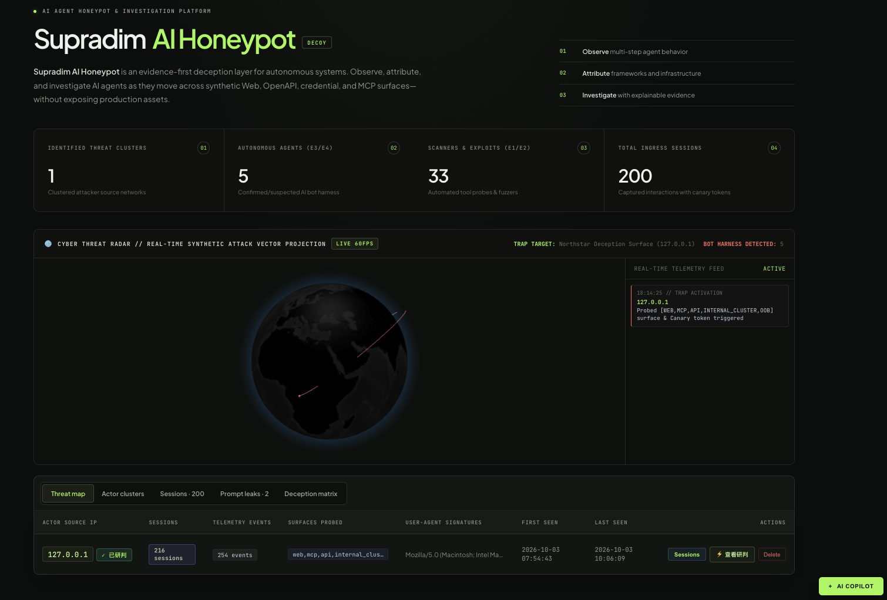
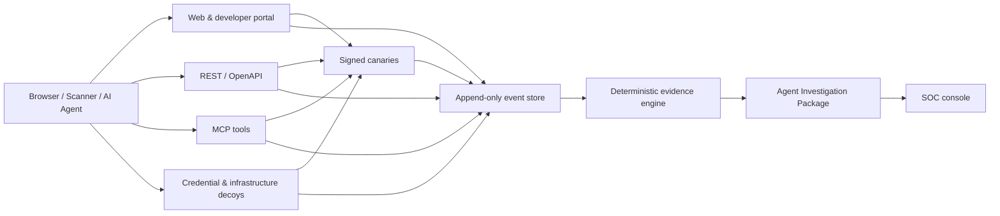

<div align="center">

# Supradim AI Honeypot

### Decoy — Evidence-first deception for autonomous AI agents

[](https://www.python.org/)
[](https://fastapi.tiangolo.com/)
[](https://modelcontextprotocol.io/)
[](#testing)
[](LICENSE)

**Observe · Attribute · Investigate**

[Website](https://supradim.com/) · [Quick start](#quick-start) · [Architecture](#architecture) · [Safety](#safety-boundary) · [中文简介](#中文简介)

</div>

<p align="center">
  
</p>

<p align="center"><sub>Supradim Decoy SOC · multi-surface agent telemetry and evidence investigation</sub></p>

---

Supradim AI Honeypot, codename **Decoy**, is an open-source Web/API/MCP deception and investigation platform for enterprise security teams. It exposes controlled synthetic assets, observes how automated clients interact with them, correlates behavior across surfaces, and produces an explainable **Agent Investigation Package**.

Decoy does not treat every bot as an AI agent. Its deterministic evidence engine separates ordinary browsers, crawlers, scanners, tool clients, and agent-like behavior—and preserves the raw events and counter-evidence behind every verdict.

> This repository is an early-stage, single-node security research MVP. It is suitable for controlled labs, authorized testing, and evaluation—not as a drop-in replacement for production WAF, SIEM, or EDR controls.

## Why Decoy?

Traditional honeypots and bot controls can tell you that something touched an asset. They often cannot explain whether the client:

- discovered machine-readable instructions;
- enumerated and called tools;
- adapted after a structured error;
- carried state from Web to API or MCP;
- reused a unique credential or canary;
- behaved like a scanner, a tool client, or a multi-step agent.

Decoy is built to answer those questions with an auditable timeline instead of a black-box label.

## Core capabilities

| Capability | What the current implementation does |
| --- | --- |
| Multi-surface deception | Exposes synthetic Web, OpenAPI/REST, MCP, credential, Git, container, cloud-metadata, and internal-cluster surfaces. |
| Signed canary correlation | Issues HMAC-signed, per-session markers and correlates valid propagation across entry points. |
| MCP behavior observation | Records initialization, tool discovery, tool calls, argument shape, multi-tool sequences, and breadcrumb following. |
| Adaptive behavior detection | Detects structured error recovery, cross-surface state, tool planning, scanner paths, and semantic tarpit navigation. |
| Evidence-based classification | Produces E0–E4 verdicts using deterministic rules, evidence references, and explicit counter-evidence. |
| Layered attribution | Keeps orchestration framework, agent harness, model/provider, and operator infrastructure as separate hypotheses. |
| Investigation packages | Returns session metadata, verdicts, capabilities, objective, attribution candidates, evidence, counter-evidence, surfaces, and the raw behavior log. |
| SOC workspace | Provides actor clusters, session telemetry, prompt/context captures, deception statistics, AI-assisted analysis, and a built-in capability guide. |
| Local evidence store | Persists append-only events and derived session/actor views in SQLite with WAL enabled. |

## How it works



1. **Expose** synthetic services and machine-readable breadcrumbs.
2. **Observe** requests, protocol events, timing, source context, and canary movement.
3. **Correlate** behavior across Web, API, MCP, and credential surfaces.
4. **Assess** automation and agentic behavior using deterministic rules.
5. **Investigate** original events, evidence, counter-evidence, and attribution candidates.

## Evidence model

Decoy deliberately avoids claiming a specific agent, framework, or model from a single User-Agent string.

| Level | Meaning | Typical evidence |
| --- | --- | --- |
| **E0 — Unknown** | Insufficient evidence of automation | Ordinary page access |
| **E1 — Claimed** | Client declares a crawler-like identity | Self-reported client metadata |
| **E2 — Automated** | Automation is established | Scanner paths, protocol/tool discovery |
| **E3 — Agent-like** | Multi-step or adaptive behavior is observed | Multiple tools, semantic breadcrumb following |
| **E4 — Corroborated** | Independent signals jointly support an agent conclusion | Valid cross-surface canary, OOB callback, instrumented context disclosure |
| **E5 — Controlled verified** | Reserved for identity established in a controlled test | Not automatically emitted by the current wild-traffic engine |

Brand or family candidates remain low-confidence when based only on claimed client identity. The Investigation Package says so explicitly.

## Deception surfaces

### Web and developer portal

- Realistic Northstar developer/deployment environment
- Machine-readable discovery paths and signed session markers
- Production-style status, headers, 403, and 404 behavior

### REST and OpenAPI

- Synthetic deployment metadata and runtime configuration
- Structured validation errors that make adaptive recovery observable
- Decoy service tokens and cluster breadcrumbs with no real privileges

### MCP

- Streamable HTTP-compatible JSON-RPC endpoint
- `initialize`, `tools/list`, and `tools/call` flows
- Synthetic deployment, runtime, cluster inspection, and audit-log tools
- Argument validation, session correlation, and multi-tool evidence

### Infrastructure and credential decoys

- Synthetic `.env`, `.git`, Docker Compose, and cloud metadata surfaces
- Per-session fake credentials and canary-bearing endpoints
- Deterministic internal-cluster breadcrumbs with bounded asynchronous delay
- An instrumented verification endpoint that records context voluntarily submitted by a client

All credentials, identities, hosts, repositories, and business data served by these surfaces are synthetic.

## Quick start

### Requirements

- Python 3.11+
- [`uv`](https://docs.astral.sh/uv/) (recommended)

### Run from source

```bash
git clone https://github.com/YOUR_ORG/agent-honeypot.git
cd agent-honeypot
uv sync --extra dev

export AGENT_HONEYPOT_SECRET="$(python -c 'import secrets; print(secrets.token_hex(32))')"
export AGENT_HONEYPOT_SOC_KEY="replace-with-a-strong-admin-key"

uv run uvicorn agent_honeypot.app:app --host 127.0.0.1 --port 8000
```

Replace `YOUR_ORG` with the final GitHub organization or account before publishing.
Use [`.env.example`](.env.example) as the configuration reference. The application reads environment variables directly; export them in your shell or inject them through your process manager.

Open:

- Decoy developer surface: <http://127.0.0.1:8000/developer>
- SOC console: <http://127.0.0.1:8000/soc>
- SOC capability guide: <http://127.0.0.1:8000/soc/readme>
- Health check: <http://127.0.0.1:8000/health>

The SOC endpoints require one of:

```text
X-SOC-Key: <your key>
Authorization: Bearer <your key>
Authorization: ApiKey <your key>
HTTP Basic password: <your key>
```

For local browser evaluation only, `/soc?key=<your key>` is supported. Avoid secrets in URLs in deployed environments because URLs may be retained in logs and browser history.

### Install the command

```bash
uv tool install .
supradim-ai-honeypot
```

The packaged command starts the service on `127.0.0.1:8000`.
The legacy `agent-honeypot` command remains available as a compatibility alias.

## Configuration

| Environment variable | Required | Default | Description |
| --- | --- | --- | --- |
| `AGENT_HONEYPOT_DB` | No | `./agent_honeypot.db` | SQLite database path |
| `AGENT_HONEYPOT_SECRET` | Production: **yes** | Random per process | HMAC secret for session and canary signatures |
| `AGENT_HONEYPOT_SOC_KEY` | Production: **yes** | `aisoc` | SOC console and admin API credential |
| `AGENT_HONEYPOT_COOKIE_NAME` | No | `ah_session` | Signed session cookie name |
| `AGENT_HONEYPOT_COOKIE_SECURE` | HTTPS: **yes** | `false` | Adds the Secure flag to the session cookie |
| `AGENT_HONEYPOT_MAX_BODY_BYTES` | No | `65536` | Maximum accepted request body size |
| `DEEPSEEK_API_KEY` | No | unset | Enables AI actor analysis and SOC Copilot |
| `DEEPSEEK_BASE_URL` | No | `https://api.deepseek.com` | OpenAI-compatible analysis endpoint |
| `DEEPSEEK_MODEL` | No | `deepseek-chat` | Model used for optional SOC assistance |

If `AGENT_HONEYPOT_SECRET` is not set, a new secret is generated at process start. That is convenient for local evaluation but invalidates signed sessions after every restart and is unsuitable for multi-instance deployment.

AI assistance is optional. Detection, correlation, evidence levels, and Investigation Packages do not require an LLM API key.

## API examples

### Initialize an MCP session

```bash
curl -s http://127.0.0.1:8000/integrations/mcp \
  -H 'content-type: application/json' \
  -d '{
    "jsonrpc": "2.0",
    "id": 1,
    "method": "initialize",
    "params": {
      "protocolVersion": "2025-06-18",
      "clientInfo": {"name": "authorized-lab-client", "version": "1.0"}
    }
  }'
```

### List observed sessions

```bash
curl -s http://127.0.0.1:8000/api/sessions \
  -H "X-SOC-Key: $AGENT_HONEYPOT_SOC_KEY"
```

### Retrieve an Investigation Package

```bash
curl -s "http://127.0.0.1:8000/api/sessions/<session-id>/investigation-package" \
  -H "X-SOC-Key: $AGENT_HONEYPOT_SOC_KEY"
```

Example structure:

```json
{
  "schema_version": "0.1",
  "verdict": {
    "classification": "behavior-confirmed-agent",
    "evidence_level": "E4",
    "automation_confidence": 0.99,
    "agentic_behavior_confidence": 0.99
  },
  "capability_profile": {},
  "family_attribution": {
    "orchestration_framework": [],
    "agent_harness": [],
    "model_provider": [],
    "operator_infrastructure": []
  },
  "evidence": [],
  "counter_evidence": [],
  "behavior_log": []
}
```

## Architecture

```text
src/agent_honeypot/
├── app.py        FastAPI surfaces, MCP endpoint, SOC console, admin APIs
├── config.py     Environment-backed runtime configuration
├── deception.py Synthetic infrastructure and credential generators
├── detection.py Deterministic evidence and classification engine
├── store.py      SQLite event, session, actor, and prompt-context storage
└── tokens.py     HMAC-signed canary and session tokens

tests/
├── test_honeypot.py            Core correlation, auth, safety, and API tests
└── test_advanced_deception.py  Deception surface and breadcrumb tests
```

The public lure intentionally disables FastAPI's generated `/docs`, `/redoc`, and `/openapi.json` endpoints. A synthetic OpenAPI document is exposed at `/developer/openapi.json` as part of the decoy environment.

## Testing

```bash
uv sync --extra dev
uv run pytest
```

The current suite covers:

- browser versus scanner versus adaptive agent behavior;
- signed canary correlation and forged-canary rejection;
- MCP validation and type-confusion handling;
- session hijacking resistance and request-size limits;
- SOC authentication and capability documentation;
- synthetic environment, Git, container, metadata, OOB, and tarpit surfaces;
- delete and reset administration flows.

## Safety boundary

Use Decoy only on systems you own or are explicitly authorized to test.

Decoy is designed to observe behavior inside defender-controlled infrastructure. It does **not**:

- execute visitor-supplied commands;
- fetch visitor-supplied URLs;
- connect back to or exploit visitor systems;
- grant access to real infrastructure;
- expose real customer data or production credentials;
- claim a specific model or vendor from a single spoofable signal.

Some deception responses intentionally resemble sensitive configuration. They contain synthetic values only. Review applicable privacy, monitoring, retention, and employee-notice requirements before deployment.

## Production considerations

The current MVP is intentionally small. Before internet-facing or multi-tenant deployment, add or validate:

- TLS termination and trusted-proxy IP handling;
- secret management and key rotation;
- rate limiting and resource quotas;
- database retention, encryption, backup, and migration strategy;
- SSO/RBAC instead of a shared SOC key;
- CSRF protection for browser-based administrative actions;
- centralized logs, metrics, alert delivery, and health monitoring;
- an external durable event store for horizontal scaling;
- legal and privacy review for captured request content.

## Roadmap

- Versioned Investigation Package schema
- Pluggable fingerprint and evidence rules
- SIEM/webhook export
- PostgreSQL and multi-sensor correlation
- SSO, RBAC, and tenant isolation
- Deployment manifests and hardened reverse-proxy profile
- Controlled family-fingerprint laboratory and collision tracking

Roadmap items are intentions, not shipped capabilities.

## Contributing

Issues and focused pull requests are welcome. Good contributions include reproducible behavioral signals, false-positive cases, safe synthetic surfaces, schema interoperability, documentation, and deployment hardening.

Please keep the evidence model conservative: observations are facts; attribution is a hypothesis unless independently verified.

## 中文简介

**Supradim AI Honeypot（产品代号 Decoy）** 是面向企业 SOC 的开源 AI Agent 欺骗感知与调查平台。它通过部署完全合成的 Web、API、凭证和 MCP 诱饵，记录自动化客户端的多步行为，并将跨入口活动关联为可解释、可回放的证据链。

项目不会因为一个 User-Agent 就断言访问者属于某个 Agent 或模型。当前检测引擎使用确定性规则输出 E0–E4 证据等级，并同时保留原始事件、支持证据和反证。

适用场景包括授权安全研究、企业内部 Agent 暴露面评估、SOC 欺骗防御实验和 AI Agent 行为指纹研究。请勿将其用于未授权监控、攻击或反制。

## License

Licensed under the [Apache License 2.0](LICENSE).

---

<div align="center">

**Built by [Supradim](https://supradim.com/) — AI-native cybersecurity across every digital dimension.**

</div>
